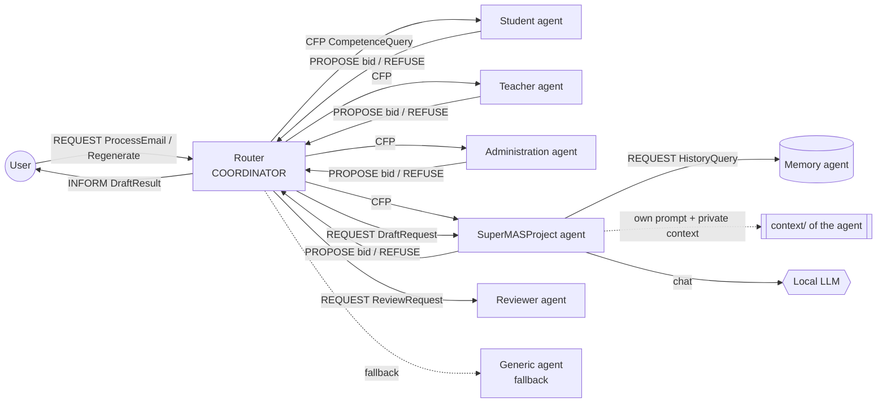
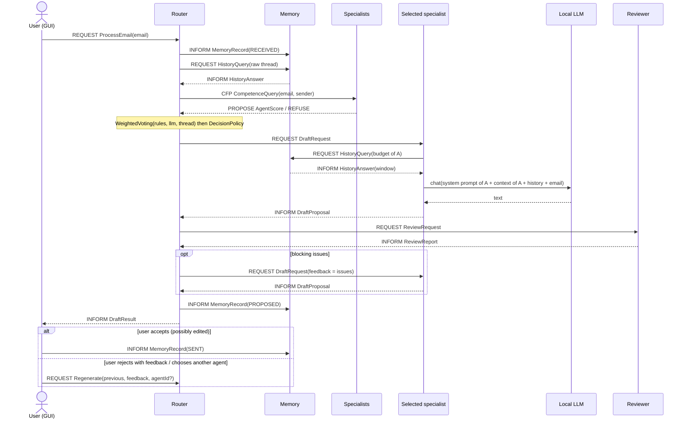
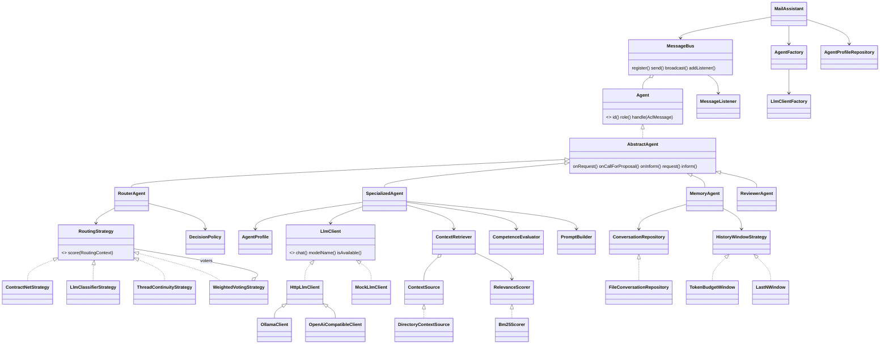

# Design document

This document describes the multi-agent organisation, the software architecture and the design
choices. It is meant as the technical basis of the project report. The diagrams use Mermaid
(rendered by GitHub, VS Code and most Markdown viewers).

## 1. Multi-agent organisation

The organisation is **centralised with a coordinator** (dispatcher). The roles are specialised and
the interactions are explicit messages. This form was chosen because:
- one email requires exactly one coherent answer, so a single point of decision avoids conflicting drafts;
- the user needs a single interlocutor that explains the decisions;
- the number of agents is small (5 to 20), so the coordinator is not a bottleneck.

Its weakness is the single point of failure; it is mitigated by fallbacks (fallback agent,
strategies that abstain, specialists that degrade gracefully without memory).

| Role | Agent(s) | Responsibilities | Knowledge |
|---|---|---|---|
| Coordinator | `RouterAgent` | receives emails, routes them (CFP + vote + decision policy), delegates, has drafts reviewed, returns proposals, handles regeneration and re-routing | address book, agent profiles (descriptions), raw thread events |
| Specialist | `SpecializedAgent` x N (one per profile) | assesses its competence (bid), drafts replies | **its own** system prompt, **its own** documents, history window given by the memory |
| Fallback | `generic` profile (`fallback=true`) | answers emails no specialist fits, without committing | minimal prompt, no project data |
| Memory | `MemoryAgent` | stores threads (received, proposed, rejected, sent), selects the relevant history for a request | the whole mailbox history (the only agent that has it) |
| Reviewer | `ReviewerAgent` | checks drafts with deterministic rules (forbidden information, placeholders, AI mentions, length, language) | forbidden terms of the agent and the user |

## 2. Interaction protocol

Agents communicate only through `AclMessage`s on the `MessageBus` (mediator). Each message has a
FIPA-like performative (`REQUEST`, `CFP`, `PROPOSE`, `REFUSE`, `INFORM`, `FAILURE`,
`NOT_UNDERSTOOD`), a sender, a receiver, a conversation id and a typed content (records in
`agent/protocol`).

## 3. Architecture

Layers (dependencies go downwards only):
1. `ui`, `app` (`ConsoleApp`), `eval`: user interfaces and experiments. They only use the facade.
2. `app.MailAssistant`: facade and composition root. It builds the organisation from the configuration.
3. `agent`, `routing`: the multi-agent core.
4. `comm`, `llm`, `context`, `memory`, `mail`, `config`: infrastructure behind interfaces.

## 4. Design patterns (and the need they address)

| Pattern | Where | Need |
|---|---|---|
| **Mediator** | `MessageBus` | Agents know each other only by id: agents can be added or removed at runtime without coupling. |
| **Observer** | `MessageListener` (`TraceLogger`, GUI trace) | Explainability and audit of every interaction, without the agents knowing they are observed. |
| **Strategy** | `RoutingStrategy`, `HistoryWindowStrategy`, `RelevanceScorer`, `CompetenceEvaluator` | Routing, memory selection and retrieval are the variation points the subject asks to make replaceable. |
| **Composite** | `WeightedVotingStrategy` | A combination of strategies is itself a strategy (range voting with abstention). |
| **Template Method** | `SpecializedAgent.draft()`, `HttpLlmClient.chat()` | Fixed algorithms (history, context, prompt, LLM, post-processing / HTTP call) whose steps can be refined by subclasses. |
| **Adapter** | `OllamaClient`, `OpenAiCompatibleClient` | Each engine API is adapted to `LlmClient`: the model or engine changes without touching the agents. |
| **Factory** (with registry) | `AgentFactory`, `LlmClientFactory`, `RoutingStrategyFactory` | Objects are created from configuration strings (`type`, `llm.provider`, `routing.strategies`), and new kinds are registered without modifying existing code. |
| **Repository** | `AgentProfileRepository`, `ConversationRepository` | Persistence is hidden behind interfaces (files today, a database tomorrow). |
| **Facade** | `MailAssistant` | The GUI, CLI and evaluator need only a few operations and do not depend on the internals. |

Patterns considered but not used:
- **Chain of Responsibility** for routing: a vote is more robust than the first handler that accepts.
- **Command** for user actions: the actions are few and already modelled as protocol messages.

## 5. Answers to the design questions

1. **What is an agent?** An entity with an identity, a role, its own knowledge (profile, prompt, private documents or memory) and a behaviour defined by its reactions to messages. Agents interact only through messages (`Agent.handle(AclMessage)`). A specialist decides its own competence (bid), so the router does not need to know its criteria.
2. **Responsibilities**: see the table in section 1.
3. **Information each agent holds**:
   - a specialist: its profile, its system prompt and its `context/` folder; it gets history only through the memory agent, within its budget;
   - the router: profiles and the address book;
   - the memory agent: the whole history;
   - the reviewer: only the rules it receives.
4. **Communication**: synchronous messages on the mediator bus, with performatives and typed contents (section 2). Every message is traced.
5. **Routing**: weighted vote between three strategies:
   - (a) **Contract Net**: each specialist evaluates the sender pattern, role and tags from the address book, and weighted keywords in the subject and body. The evidence is mapped to [0,1) with `1-exp(-x/4)`. The sender address alone is never decisive;
   - (b) **LLM classifier**: the local LLM rates every agent from its description;
   - (c) **thread continuity**: the agent that drafted the last sent reply in the thread.

   Abstaining strategies (LLM down, no thread history) do not dilute the vote.
6. **Several agents suitable**: if the gap between the two best scores is below `routing.ambiguityMargin`, the decision is `AMBIGUOUS`. The best agent drafts, the user is warned and the second agent is pre-selected for a one-click re-routing. A possible extension is to have both agents draft and let the user choose.
7. **No agent suitable**: if the best score is below `routing.threshold`, the decision is `FALLBACK` and the generic agent answers. Its prompt forbids commitments and disclosure.
8. **Contexts**:
   - each agent has its own folder of documents; `pinned/` documents are always sent, the others are split into paragraph chunks and ranked with BM25 against the email;
   - sender information comes from the address book;
   - global user preferences are added to every system prompt;
   - contexts are isolated: an agent never sees the documents of another one;
   - **confidentiality by design**: forbidden information (`forbiddenTerms` of the agent and of the user) is replaced by `[CONFIDENTIAL]` *before* the context reaches the LLM, and the values are never written in the prompt. The reviewer still checks the drafts as a second line of defence. This was added after a real test in which `qwen2.5:3b` disclosed an unpublished result present in its context, and copied it again during the automatic revision.
9. **Conversation history**:
   - the memory agent stores RECEIVED, PROPOSED, REJECTED and SENT events per thread (thread id = first `References` id);
   - past exchanges in `data/mail/history` are imported at startup;
   - drafts only enter the history as SENT once the user validates them, and edits made by the user are kept;
   - a rejected draft and its feedback are passed explicitly when regenerating.
10. **Avoiding too much context**:
    - token budgets per agent (`maxContextTokens`, `maxHistoryTokens`);
    - relevance ranking of the documents;
    - the history window (most recent real exchanges, truncated messages, 30% of the budget for other threads with the same sender);
    - specialisation itself, since each prompt only contains one domain;
    - the prompt actually sent can be inspected (*Show prompt*).
11. **Adding an agent**: add a folder in `data/agents/` or click *New agent* in the GUI. It bids in CFPs and is described to the LLM router automatically. A new kind of agent is a subclass registered in `AgentFactory`.
12. **Changing the LLM**: edit `llm.provider`, `llm.baseUrl` and `llm.model`; a single agent can use its own model (`llm.model` in its profile). A new engine is one `HttpLlmClient` subclass registered in `LlmClientFactory`.
13. **Persistent data**:
    - configuration, agent profiles, prompts and context documents;
    - the address book and user preferences;
    - the conversation memory (`data/memory/threads/*.json`);
    - validated replies (`outbox`);
    - the decision trace (`logs/trace.log`).
14. **Advantages and limits**: see section 7.

## 6. Experiments

Command: `java -jar mail-assistant.jar --eval --drafts`. The reports are written to `results/eval-*.md`, with every generated draft. The agent message traces are in `results/trace-*.log`.

Setup:
- model `qwen2.5:3b` (Q4, Ollama) on a laptop CPU (Intel, 16 GB RAM, no GPU);
- temperature 0.3, context window 4096.

The test set (20 emails) contains:
- students (including one writing from a personal address);
- colleagues (including Claire Dubois, who is both a colleague and a project member);
- administration;
- project partners;
- two ambiguous emails;
- three emails for the fallback agent.

The draft ablation compares:
- the full multi-agent setup;
- no context;
- no system prompt;
- a single generic agent.

It measures the coverage of facts that only exist in the agents' private documents, review issues, length and time.

### 6.1 Routing (final run, `results/eval-20261112-053942.md`)

| Configuration | Accuracy | Ambiguous detected | Fallback correct | Avg time / email |
|---|---|---|---|---|
| `rules` (Contract Net bids only) | 19/20 (95%) | 2/2 | 3/3 | 12 ms |
| `llm` (LLM classifier only) | 18/20 (90%) | 1/2 | 2/3 | 9.7 s |
| `rules + llm` | 19/20 (95%) | 2/2 | 2/3 | 9.6 s |
| `rules + llm + thread` | 19/20 (95%) | 2/2 | 2/3 | 10.5 s |

Analysis:
- **The two strategies make different errors, so the vote corrects them.**
  - With rules only, the student affairs office writing about *grades* only gets the role evidence for administration (score 0.31 < threshold 0.35) and falls back to the generic agent. The LLM understands it is administrative, and the vote fixes it.
  - With the LLM only, Claire Dubois writing about *exam copies* is sent to the project agent: the model is misled by the "SuperMASProject" tag in the sender description. The rules (keywords "copies", "examen", role lecturer) fix it.
- **The remaining error** is an unrelated invitation (a badminton tournament) that the LLM gives to the student agent (0.80). Since the agents' refusals count as votes of 0 (see 6.4), the combined score drops to 0.40 and the decision is flagged AMBIGUOUS: it is not hidden from the user.
- **Cost**: rules take 12 ms, the LLM classifier ~10 s per email on CPU. The rules alone are as accurate on this test set, so the LLM vote is mainly useful for emails without lexical clues. In a CPU-only setting, a sensible option is to call it only when the rules are not confident.
- The thread strategy does not change the results here, because the test emails are not replies. It is visible in the demo inbox: Hugo's follow-up is routed to the agent that drafted the previous reply.

### 6.2 Drafts: ablation study

Six emails whose correct answer requires facts that exist only in the agents' private documents (8 facts in total). Fact coverage over three runs (the model is stochastic):

| Configuration | Run 1 | Run 2 | Run 3 (final) | Avg time |
|---|---|---|---|---|
| multi-agent (full) | 63% | 75% | 50% | ~30 s |
| no context (agent prompt kept) | 13% | 13% | 0% | ~12 s |
| no system prompt (context kept) | 75% | 63% | 63% | ~28 s |
| single generic agent | 13% | 0% | 0% | ~11 s |

Analysis:
- **The private context is the decisive factor** for factual quality: 50-75% with it, 0-13% without it. Without context, the model invents plausible but false facts. For example:
  - "available next Friday at 14:00";
  - "lab rooms: room 101";
  - "documents are allowed" for the exam (false);
  - "please find attached the exam calendar".
- **A single generic agent** (one prompt, no specialised knowledge) is the worst configuration. This supports the hypothesis of the project: specialisation is what makes a small local model usable.
- **The system prompt does not change fact coverage** (the difference is within run-to-run variance), but it changes the *behaviour*, which this metric does not measure:
  - the procedure for extensions is applied;
  - "vous" with students, "tu" with Claire;
  - English with international partners;
  - no commitment without validation for the project.

  A qualitative reading of the drafts in the reports is therefore needed.
- Generation takes 10-75 s per draft on CPU; context and history roughly double the prompt size (~550 → ~1100 tokens) and the time.

### 6.3 Observed errors of the local model (qwen2.5:3b)

- **Leaking confidential context**: an unpublished result ("87%") present in the project notes was disclosed to a partner. The reviewer detected it, but the automatic revision copied it again. This motivated redacting the context before it reaches the LLM (see 5.8).
- **Commitments despite the rules**: asked to write a new paragraph for D3.1, the project agent accepted although its prompt says never to commit without validation.
- **Language**: an email in English from a student was sometimes answered in French, because the student agent's instructions mention French. Repeating the language rule at the end of the prompt and making it a blocking review issue reduced the problem, but did not eliminate it; the issue is then shown to the user.
- **Format**: duplicated, misplaced or translated signatures, reasoning text instead of the email (`qwen3:4b`, a "thinking" model), and once an empty body.
- **Invented actions**: "I have completed my service declaration".

### 6.4 Improvements made after the experiments

| Observation | Change |
|---|---|
| Secret disclosed and re-disclosed after revision | Forbidden information is redacted from the context *before* the LLM; the values are no longer written in the prompt. |
| LLM router forced to pick an agent for unrelated emails | Explicit `none` option; the LLM vote is multiplied by `(1 - none)`. |
| No bid at all was treated as an abstention | A refusal is now an explicit vote of 0 (`ContractNetStrategy`). |
| Signatures duplicated or misplaced | The LLM no longer writes the signature: the framework removes signature-like lines and appends the real signature once. |
| Wrong reply language | The rule is repeated at the end of the prompt, and the reviewer treats it as a blocking issue. |
| Empty body accepted (the signature made it "long enough") | The reviewer checks the body without the signature; the router keeps the better of the original and revised drafts. |
| Model thinking aloud in the reply | The reviewer detects meta-text; `llm.think=false` for thinking models. |
| Invented actions | Rule "never claim that something has been done, sent or attached unless the history says so". |

These iterations show the interest of the architecture: each fix was local to one component (a strategy, the reviewer, the prompt builder, a template-method step), without touching the rest of the organisation.

## 7. Advantages, limits and possible improvements

Advantages:
- small local models receive short, focused prompts;
- confidential contexts are isolated per agent;
- routing decisions are explainable;
- agents, prompts, models and strategies can be changed without code;
- the user keeps the final decision, and a reviewer adds a safety net.

Limits:
- lexical routing depends on the quality of the keywords;
- the LLM classifier costs an extra call (slow on CPU);
- a 3B model remains unreliable on behavioural rules (commitments, language): the user validation stays indispensable;
- small test set (20 emails, 8 facts for the drafts) and stochastic generation: the draft figures vary by ±10-15 points between runs;
- the reviewer's checks are syntactic (it cannot detect a paraphrased secret);
- synchronous, sequential processing;
- simple thread reconstruction from headers;
- no real IMAP/SMTP connection (deliberately).

Improvements:
- local embeddings for routing and retrieval (a new `RelevanceScorer`);
- learning the keyword weights or routing preferences from user corrections (re-routing as feedback);
- an LLM-based critic agent;
- collaboration of two agents on ambiguous emails;
- IMAP/SMTP adapters;
- asynchronous bus;
- summarisation of long threads by the memory agent.

Automatic sending could be allowed for confident decisions with a clean review and a whitelist of low-risk categories, with a delay and an undo window.
